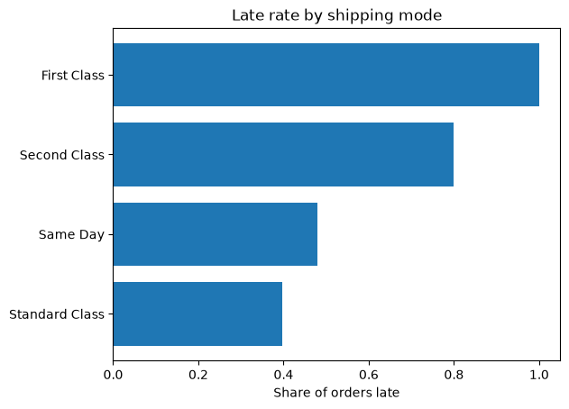
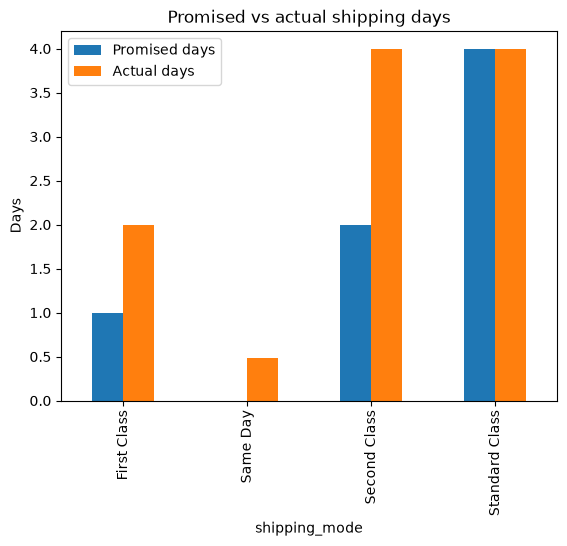

# Why 57% of Orders Arrive Late: Supply Chain Analysis

## Summary
57% of orders arrive late. First Class and Second Class are 35% of orders
but cause 54% of all late deliveries. Their promised windows (1 and 2 days)
are shorter than what the carrier actually delivers (2 and 4 days).
Resetting those promises would cut the late rate from 57% to about 26%.

## Business question
Where is the supply chain losing time, and what should change first?

## Data
DataCo Smart Supply Chain dataset (Kaggle): 180,519 order lines, 53 columns.
Link: https://www.kaggle.com/datasets/shashwatwork/dataco-smart-supply-chain-for-big-data-analysis
The data files are not included here because of their size.

## What I did
- Cleaned the data: standardized column names, dropped two unusable columns
  (an empty product description and a mostly empty zipcode)
- Built a "days late" metric: actual shipping days minus promised days
- Flagged each order as late or on time
- Excluded canceled orders from lateness checks
- Compared late rates by shipping mode, region, product category and month

## Key findings
| Shipping mode | Promised days | Actual days | Late rate |
|---|---|---|---|
| First Class | 1 | 2.0 | 100% |
| Second Class | 2 | 4.0 | 80% |
| Same Day | 0 | 0.5 | 48% |
| Standard Class | 4 | 4.0 | 40% |

- Region, product category and month barely changed the late rate
  (about 52 to 59%), so they are not the cause.
- Impact: if First and Second Class were never late, the overall late
  rate would fall from 57.3% to 26.3%.

## Recommendation
Reset the promised windows for First Class (1 to 2 days) and Second Class
(2 to 4 days) so they match real delivery times.

## Limitations
- The 26% figure is a best case, not a forecast. It assumes both modes
  become never late.
- Slower promises may cost customers, and this data cannot measure that.
- First Class is late 100% of the time with exactly 2 days of shipping,
  which looks synthetic. Real carriers vary more.
- Standard Class and Same Day still have 40 to 48% late rates and need
  separate work.

## Tools
Python, pandas, matplotlib, Jupyter

## Next steps
ABC product analysis, dashboard, supplier analysis (needs a second dataset).

## Files
- `01_cleaning.ipynb`: cleaning and analysis
